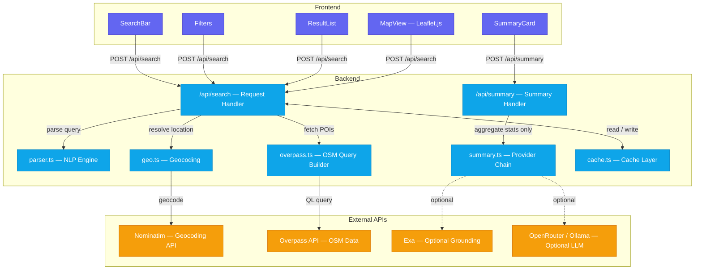

# Lighthouse

Geospatial infrastructure intelligence platform for discovering and analyzing physical-world assets using OpenStreetMap data, with optional AI-assisted aggregate summaries.


## Overview

Lighthouse enables searching, monitoring, and analyzing real-world infrastructure including:

- Telecommunications towers and data centers
- Power plants, substations, and energy storage
- Airports, helipads, and cable transport (gondolas, funiculars)
- Ports, harbours, piers, and maritime facilities
- Warehouses and industrial facilities
- Pipelines, refineries, and energy infrastructure
- Military installations
- Hospitals, prisons, embassies, and government facilities
- Surveillance cameras and emergency infrastructure
- Transportation hubs (train stations, bus stations, taxi stands)

And many more asset types across 30+ categories with over 200 searchable infrastructure types.

## Architecture



## AI Summaries

After each successful search, Lighthouse requests a short summary of the aggregate result set.

- Only aggregate data is sent: query, parsed scope, total count, top feature types/operators, and truncation status. Individual asset names, tags, and coordinates are never sent.
- Provider order: optional Exa grounding, then OpenRouter, then Ollama, then Exa Answer, then a deterministic local fallback.
- Exa grounding is used only when an LLM provider is configured. Exa Answer is used only if both OpenRouter and Ollama fail or are unavailable.
- AI summaries are cached for 6 hours, deduplicated in flight, and limited to 6 requests per IP per minute and 40 provider calls per day by default.
- Local summaries are always available without API keys and are not cached.
- AI output is generated from aggregate counts and may be incomplete or wrong. Verify important details against authoritative sources.

## Data Sources

### OpenStreetMap

All infrastructure data comes from [OpenStreetMap](https://www.openstreetmap.org/), a collaborative mapping project. OSM data is crowd-sourced and may contain inaccuracies or gaps.

### Nominatim

Geographic resolution uses the [Nominatim](https://nominatim.openstreetmap.org/) geocoding service to convert place names to bounding boxes and coordinates.

### Overpass API

Infrastructure queries execute against the [Overpass API](https://overpass-api.de/), which provides read-only access to OSM data.

With `OVERPASS_CH_KEY` set, queries run against [overpass.ch](https://overpass.ch/) first (a keyed instance of the same API) and fall back to the public mirrors. Geocoding then prefers its Nominatim-compatible endpoint too, which allows 300 requests/min instead of the public 1 request/second. The key is server-side only: never expose it as `NEXT_PUBLIC_*`, since it travels in the request path.

### Exa (Optional)

When configured, [Exa](https://exa.ai/) can provide public reference context for AI summaries and act as the final AI fallback. Exa is never used as the source of infrastructure counts or locations.

## Query Syntax

### Natural Language

```
telecom towers in karnataka
power plants near mumbai
data centers in california
airports in germany
```

### Structured Queries

```
type:telecom operator:airtel region:karnataka
type:data_center operator:google
type:substation region:texas
type:airport country:france
```

### Supported Parameters

| Parameter | Description | Example |
|-----------|-------------|---------|
| `type:` | Asset type | `type:power_plant` |
| `operator:` | Operator/owner | `operator:google` |
| `region:` | State/region | `region:bavaria` |
| `country:` | Country | `country:india` |
| `near:` | Proximity search | `near:london` |
| `radius:` | Search radius (km) | `radius:100` |

### Supported Asset Types

#### Energy & Power
| Type | Aliases | Description |
|------|---------|-------------|
| `power_plant` | `powerplant` | Power generation facilities |
| `substation` | - | Electrical substations |
| `transformer` | - | Power transformers |
| `converter` | - | Power converters |
| `switch` | - | Power switches |
| `power_line` | - | High voltage power lines |
| `power_pole` | - | Power distribution poles |
| `solar` | - | Solar farms and panels |
| `wind` | - | Wind farms and turbines |
| `nuclear` | `nuclear_site` | Nuclear power plants |
| `hydroelectric` | - | Hydroelectric plants |
| `geothermal` | - | Geothermal plants |
| `coal` | - | Coal power plants |
| `gas_power` | - | Gas power plants |
| `oil_power` | - | Oil power plants |
| `biogas` | - | Biogas plants |
| `biomass` | - | Biomass plants |
| `tidal` | - | Tidal power plants |
| `battery_storage` | - | Battery energy storage |

#### Telecommunications
| Type | Aliases | Description |
|------|---------|-------------|
| `telecom` | `tower` | Telecom towers |
| `antenna` | - | Antennas |
| `mast` | - | Communication masts |
| `cell_tower` | - | Mobile cell towers |
| `radio_tower` | - | Radio transmission towers |
| `broadcast_tower` | - | TV/Radio broadcast towers |
| `satellite_dish` | - | Satellite dishes |
| `telephone_exchange` | - | Telephone exchanges |
| `data_center` | `datacenter` | Data centers |

#### Oil, Gas & Mining
| Type | Aliases | Description |
|------|---------|-------------|
| `refinery` | - | Oil refineries |
| `pipeline` | - | Pipelines |
| `oil_well` | - | Oil extraction wells |
| `gas_well` | - | Gas extraction wells |
| `storage_tank` | - | Fuel/liquid storage tanks |
| `silo` | - | Storage silos |
| `gasometer` | - | Gas storage tanks |
| `quarry` | `mine` | Quarries and mines |
| `landfill` | - | Landfill sites |
| `scrap_yard` | - | Scrap yards |

#### Water & Utilities
| Type | Aliases | Description |
|------|---------|-------------|
| `water_tower` | - | Water towers |
| `water_treatment` | - | Water treatment plants |
| `wastewater` | `sewage`, `sewage_plant` | Wastewater plants |
| `dam` | - | Dams |
| `reservoir` | - | Reservoirs |
| `pumping_station` | - | Water pumping stations |
| `water_well` | - | Water wells |

#### Aviation
| Type | Aliases | Description |
|------|---------|-------------|
| `airport` | - | Airports |
| `helipad` | - | Helipads |
| `airfield` | - | Military/private airfields |
| `runway` | - | Airport runways |
| `taxiway` | - | Airport taxiways |
| `terminal` | - | Airport terminals |
| `hangar` | - | Aircraft hangars |
| `atc_tower` | - | Air traffic control towers |

#### Maritime
| Type | Aliases | Description |
|------|---------|-------------|
| `port` | `seaport` | Ports and seaports |
| `harbour` | - | Harbours |
| `ferry_terminal` | - | Ferry terminals |
| `marina` | - | Marinas |
| `shipyard` | - | Shipyards |
| `dock` | - | Docks |
| `lighthouse` | - | Lighthouses |
| `pier` | - | Piers |
| `jetty` | - | Jetties |
| `slipway` | - | Boat slipways |
| `mooring` | - | Moorings |
| `boat_lift` | - | Boat lifts |

#### Rail & Transit
| Type | Aliases | Description |
|------|---------|-------------|
| `train_station` | - | Train stations |
| `railyard` | `rail_yard` | Rail yards |
| `metro` | - | Metro/subway stations |
| `tram_stop` | - | Tram stops |
| `halt` | - | Railway halts |
| `level_crossing` | - | Level crossings |
| `bus_station` | - | Bus stations |
| `parking` | - | Parking facilities |
| `toll_booth` | - | Toll booths |
| `weigh_station` | - | Truck weigh stations |
| `rest_area` | - | Highway rest areas |
| `service_area` | - | Highway service areas |

#### Structures
| Type | Aliases | Description |
|------|---------|-------------|
| `building` | - | General buildings |
| `bridge` | - | Bridges |
| `tunnel` | - | Tunnels |
| `cooling_tower` | - | Cooling towers |
| `chimney` | - | Industrial chimneys |
| `crane` | - | Cranes |
| `windmill` | - | Windmills |
| `watermill` | - | Watermills |
| `clock_tower` | - | Clock towers |
| `bell_tower` | - | Bell towers |

#### Industrial & Commercial
| Type | Aliases | Description |
|------|---------|-------------|
| `warehouse` | - | Warehouses |
| `factory` | - | Factories |
| `industrial` | - | Industrial zones |
| `works` | - | Industrial works |
| `depot` | - | Depots |
| `brewery` | - | Breweries |
| `distillery` | - | Distilleries |
| `sawmill` | - | Sawmills |
| `slaughterhouse` | - | Slaughterhouses |
| `recycling_plant` | `recycling` | Recycling plants |

#### Military & Defense
| Type | Aliases | Description |
|------|---------|-------------|
| `military` | - | Military installations |
| `bunker` | - | Bunkers |
| `barracks` | - | Military barracks |
| `naval_base` | - | Naval bases |
| `range` | - | Firing/shooting ranges |
| `checkpoint` | - | Military checkpoints |
| `radar` | - | Radar installations |

#### Government & Public Safety
| Type | Aliases | Description |
|------|---------|-------------|
| `embassy` | - | Embassies |
| `courthouse` | - | Courthouses |
| `townhall` | - | Town halls |
| `government` | - | Government offices |
| `customs` | - | Customs offices |
| `tax_office` | - | Tax offices |
| `border_control` | - | Border control points |
| `police` | - | Police stations |
| `fire_station` | - | Fire stations |
| `prison` | - | Prisons |
| `ambulance_station` | - | Ambulance stations |
| `rescue_station` | - | Rescue stations |
| `coast_guard` | - | Coast guard stations |
| `emergency_phone` | - | Emergency phones |
| `fire_hydrant` | - | Fire hydrants |
| `lifeguard` | - | Lifeguard stations |
| `surveillance_camera` | `cctv` | Surveillance cameras |

#### Education & Research
| Type | Aliases | Description |
|------|---------|-------------|
| `school` | - | Schools |
| `university` | - | Universities |
| `college` | - | Colleges |
| `kindergarten` | - | Kindergartens |
| `driving_school` | - | Driving schools |
| `research` | - | Research institutes |
| `library` | - | Libraries |

#### Healthcare
| Type | Aliases | Description |
|------|---------|-------------|
| `hospital` | - | Hospitals |
| `clinic` | - | Clinics |
| `pharmacy` | - | Pharmacies |
| `dentist` | - | Dental practices |
| `veterinary` | - | Veterinary clinics |
| `nursing_home` | - | Nursing homes |
| `hospice` | - | Hospices |
| `blood_bank` | - | Blood banks |

#### Culture & Entertainment
| Type | Aliases | Description |
|------|---------|-------------|
| `museum` | - | Museums |
| `theatre` | - | Theatres |
| `cinema` | - | Cinemas |
| `stadium` | - | Stadiums |
| `sports_centre` | - | Sports centres |
| `swimming_pool` | - | Swimming pools |
| `golf_course` | - | Golf courses |
| `racetrack` | - | Racetracks |
| `ice_rink` | - | Ice rinks |

#### Tourism & Leisure
| Type | Aliases | Description |
|------|---------|-------------|
| `hotel` | - | Hotels |
| `campsite` | - | Campsites |
| `caravan_site` | - | Caravan sites |
| `theme_park` | - | Theme parks |
| `zoo` | - | Zoos |
| `aquarium` | - | Aquariums |
| `viewpoint` | - | Viewpoints |
| `attraction` | - | Tourist attractions |
| `information` | - | Tourist information centers |
| `picnic_site` | - | Picnic sites |

#### Religious
| Type | Aliases | Description |
|------|---------|-------------|
| `church` | - | Churches |
| `mosque` | - | Mosques |
| `temple` | - | Temples |
| `synagogue` | - | Synagogues |
| `place_of_worship` | - | General places of worship |
| `cemetery` | - | Cemeteries |

#### Historic
| Type | Aliases | Description |
|------|---------|-------------|
| `monument` | - | Monuments |
| `memorial` | - | Memorials |
| `castle` | - | Castles |
| `fort` | - | Forts |
| `ruins` | - | Ruins |
| `archaeological_site` | - | Archaeological sites |
| `observatory` | - | Observatories |

#### Agriculture
| Type | Aliases | Description |
|------|---------|-------------|
| `farm` | - | Farms |
| `greenhouse` | - | Greenhouses |
| `orchard` | - | Orchards |
| `vineyard` | - | Vineyards |

#### Services
| Type | Aliases | Description |
|------|---------|-------------|
| `bank` | - | Banks |
| `atm` | - | ATMs |
| `post_office` | - | Post offices |
| `post_box` | - | Post boxes |
| `fuel` | `gas_station`, `petrol` | Fuel stations |
| `charging_station` | - | EV charging stations |
| `taxi_stand` | - | Taxi stands |
| `car_wash` | - | Car washes |
| `bicycle_repair` | - | Bicycle repair stations |

#### Public Utilities
| Type | Aliases | Description |
|------|---------|-------------|
| `bicycle_parking` | - | Bicycle parking |
| `drinking_water` | - | Drinking water fountains |
| `public_toilet` | - | Public toilets |
| `bench` | - | Public benches |
| `waste_basket` | - | Waste baskets |
| `street_lamp` | - | Street lamps |
| `traffic_signals` | - | Traffic signals |
| `telephone` | - | Public telephones |

#### Cable Transport
| Type | Aliases | Description |
|------|---------|-------------|
| `aerialway` | - | Cable cars |
| `gondola` | - | Gondolas |
| `funicular` | - | Funiculars |
| `chairlift` | - | Chairlifts |

#### Emergency Infrastructure (Additional)
| Type | Aliases | Description |
|------|---------|-------------|
| `siren` | - | Emergency sirens |
| `defibrillator` | - | Public defibrillators |
| `assembly_point` | - | Emergency assembly points |
| `life_ring` | - | Life rings |

#### Commercial & Retail
| Type | Aliases | Description |
|------|---------|-------------|
| `supermarket` | - | Supermarkets |
| `mall` | - | Shopping malls |
| `marketplace` | - | Marketplaces |

#### Shared Mobility
| Type | Aliases | Description |
|------|---------|-------------|
| `bicycle_rental` | - | Bike sharing stations |
| `car_sharing` | - | Car sharing locations |

#### Science & Research (Additional)
| Type | Aliases | Description |
|------|---------|-------------|
| `planetarium` | - | Planetariums |
| `laboratory` | - | Laboratories |

#### Construction
| Type | Aliases | Description |
|------|---------|-------------|
| `construction_site` | - | Construction sites |

#### Food & Beverage Production
| Type | Aliases | Description |
|------|---------|-------------|
| `winery` | - | Wineries |
| `bakery` | - | Bakeries |
| `dairy` | - | Dairies |

#### Food Services
| Type | Aliases | Description |
|------|---------|-------------|
| `restaurant` | - | Restaurants |
| `cafe` | - | Cafes |
| `fast_food` | - | Fast food restaurants |

#### Recreation
| Type | Aliases | Description |
|------|---------|-------------|
| `playground` | - | Playgrounds |
| `park` | - | Parks |
| `pitch` | - | Sports pitches |

#### Water Features
| Type | Aliases | Description |
|------|---------|-------------|
| `fountain` | - | Fountains |
| `waterfall` | - | Waterfalls |
| `hot_spring` | - | Hot springs |

#### Monitoring & Weather
| Type | Aliases | Description |
|------|---------|-------------|
| `monitoring_station` | - | Environmental monitoring |
| `weather_station` | - | Weather stations |

#### Community Facilities
| Type | Aliases | Description |
|------|---------|-------------|
| `community_centre` | - | Community centres |
| `social_facility` | - | Social facilities |
| `shelter` | - | Public shelters |

## Development

### Prerequisites

- Node.js 22+
- npm

### Setup

```bash
npm install
cp .env.example .env.local   # optional; only needed for AI providers
npm run dev
```

Open [http://localhost:3000](http://localhost:3000).

### Tests and Checks

```bash
npm run lint
npm run typecheck
npm test
npm run build
```

### Project Structure

```
app/
├── page.tsx              # Main application page
├── layout.tsx            # Root layout
├── globals.css           # Global styles
└── api/
    ├── search/
    │   └── route.ts      # Search API endpoint
    ├── summary/
    │   └── route.ts      # AI summary endpoint
    └── nominatim/
        └── route.ts      # Rate-limited geocoding proxy

components/
├── SearchBar.tsx         # Query input
├── Filters.tsx           # Filter sidebar
├── ResultList.tsx        # Paginated results display
├── SummaryCard.tsx       # AI/local summary display
├── MapView.tsx           # Leaflet map
├── ShareButton.tsx       # Share functionality
└── ui/
    └── scroll-area.tsx   # UI components

lib/
├── types.ts              # Type definitions
├── parser.ts             # Query parsing and NLP
├── geo.ts                # Nominatim integration
├── overpass.ts           # Overpass API queries
├── summary.ts            # Provider chain and local summary
├── cache.ts              # In-memory caching
├── search-index.ts       # Search indexing
└── __tests__/            # Parser, Overpass, and summary tests
```

## Deployment

### Vercel

```bash
npm install -g vercel
vercel
```

### Environment Variables

No environment variables are required. Without provider keys, Lighthouse uses the deterministic local summary and public OpenStreetMap APIs.

See `.env.example` for optional OpenRouter, Ollama, and Exa configuration. Provider requests are server-side; keys are never exposed to the browser.

| Variable | Purpose |
|----------|---------|
| `OPENROUTER_API_KEY` | Primary AI summary provider |
| `OPENROUTER_MODEL` | OpenRouter model (default `openrouter/free`) |
| `OLLAMA_API_KEY` | Ollama Cloud key |
| `OLLAMA_BASE_URL` | Local or self-hosted Ollama base URL |
| `OLLAMA_MODEL` | Ollama model; auto-discovered if omitted |
| `OVERPASS_CH_KEY` | Optional overpass.ch key: preferred Overpass and geocoding instance |
| `EXA_API_KEY` | Optional Exa grounding and final answer fallback |
| `EXA_SEARCH_TYPE` | Exa search type (default `auto`) |
| `EXA_NUM_RESULTS` | Grounding results per summary (default 4) |
| `SUMMARY_RATE_LIMIT_PER_MINUTE` | Per-IP AI requests per minute (default 6) |
| `SUMMARY_DAILY_LIMIT` | Global AI provider calls per day (default 40) |
| `SUMMARY_PROVIDER_TIMEOUT_MS` | Per-provider timeout (default 12000) |
| `SUMMARY_CACHE_TTL_MS` | AI summary cache TTL (default 6 hours) |

### API Rate Limits

- Nominatim: 1 request/second (enforced by Nominatim usage policy)
- Overpass API: Fair use, avoid heavy queries
- AI summaries: local fallback is unlimited; provider calls are rate-limited as described above

## Responsible Use

This tool accesses publicly available OpenStreetMap data. Users must:

1. Respect [OpenStreetMap's tile usage policy](https://operations.osmfoundation.org/policies/tiles/)
2. Respect [Nominatim usage policy](https://operations.osmfoundation.org/policies/nominatim/)
3. Respect [Overpass API usage policy](https://wiki.openstreetmap.org/wiki/Overpass_API#Public_Overpass_API_instances)
4. Not use this tool for illegal surveillance or harmful purposes
5. Acknowledge that OSM data may be incomplete or inaccurate
6. Not perform bulk automated queries that overload public infrastructure
7. For issues regarding the map, please refer to [https://www.openstreetmap.org/fixthemap](https://www.openstreetmap.org/fixthemap)
8. Treat AI summaries as unverified context, not as an authoritative assessment

The presence or absence of infrastructure in OSM should not be taken as authoritative. Always verify critical information through official sources.

## License

The original copyright notice is retained in [LICENSE](LICENSE).
